# Обновление 3.3.0

  

  

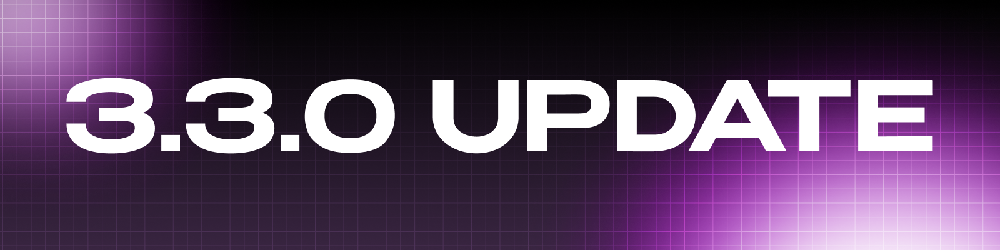

  

  

## Что нового

Большое обновление: переработаны вкладка сборок, работа с модами и мирами, появились бэкапы, анализатор конфликтов и логов, а также новый интерфейс.

## Добавлено

## - Новая вкладка сборок

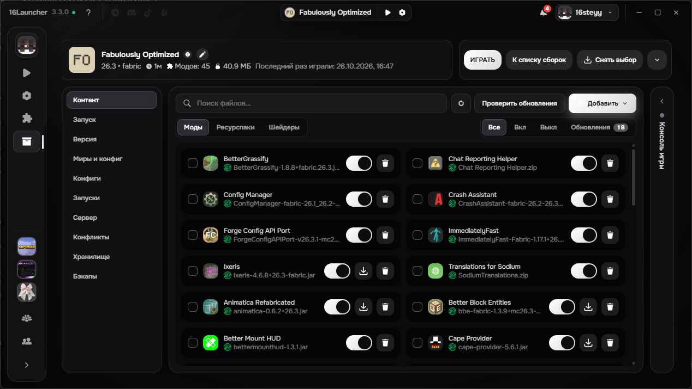
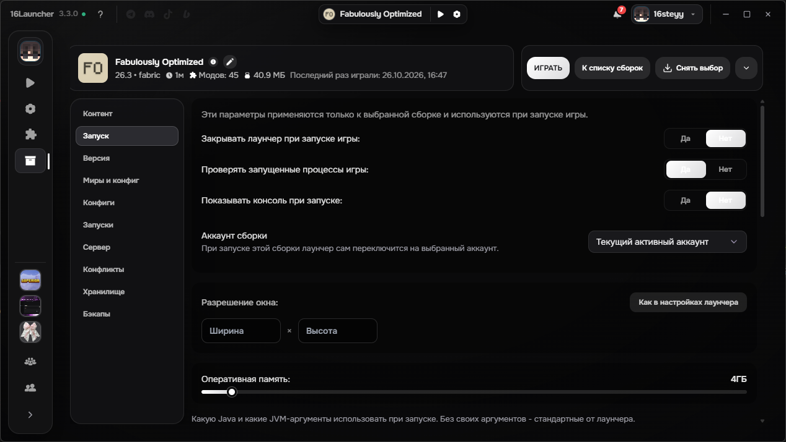

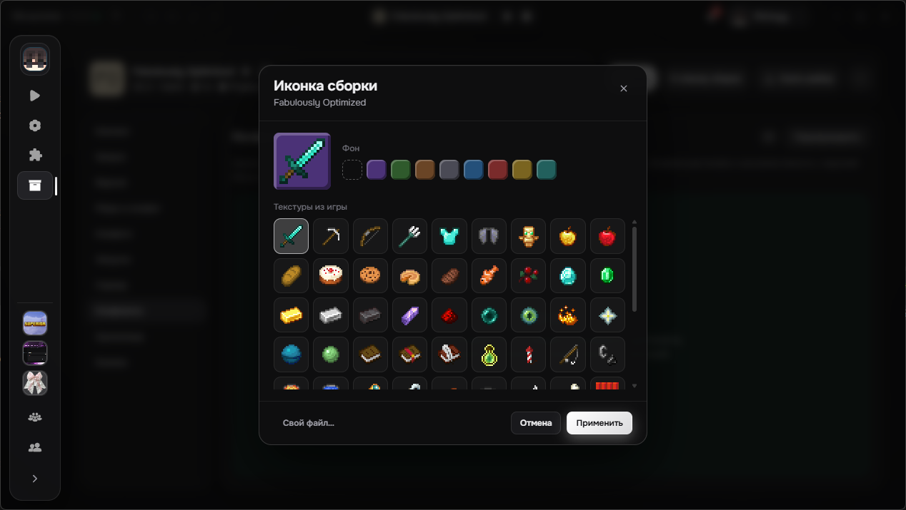

- Вкладка сборок разделена на отдельные экраны: список, создание, импорт и управление.
- Сборки можно объединять в группы и переносить между ними перетаскиванием.
- Для каждой сборки можно выбрать свой аккаунт, а иконку задать файлом или текстурой из игры.

## - Бэкапы сборок и миров

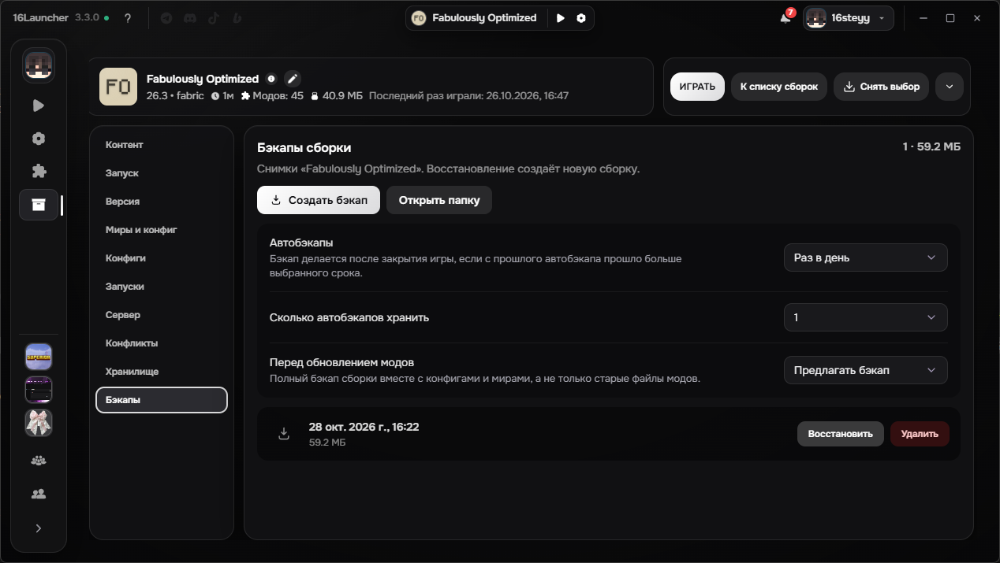

- Создавайте бэкапы вручную, по расписанию (раз в день или раз в неделю) или перед обновлением модов.
- Миры сохраняются автоматически после игровой сессии.
- Восстановление создаёт новую сборку или мир, поэтому текущие данные не пропадут.
- Перед обновлением модов старые файлы сохраняются, их можно вернуть в любой момент.

## - Анализатор конфликтов модов

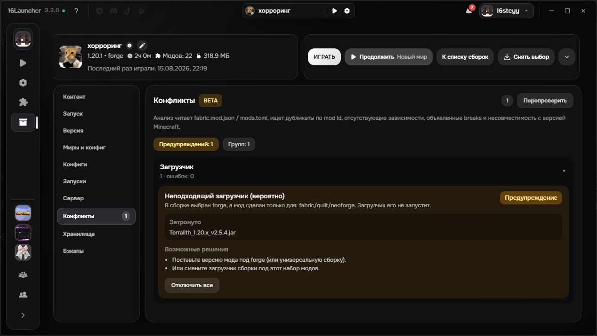

- Лаунчер находит дубликаты, моды с неподходящим загрузчиком, несовместимые моды и отсутствующие зависимости.
- Для каждой проблемы есть готовое действие: оставить новейшую версию, отключить лишние или включить нужный мод.
- Поиск модов теперь работает по названию, а не только по имени файла.

## - Анализатор логов и крашей

- Около 30 правил помогут понять причину вылета: нехватка памяти, неподходящая версия Java, битый файл, драйвер видеокарты и другие.
- Исправить проблему можно прямо из результата: увеличить память, сбросить Java или отключить мод, который вызвал сбой.
- Правила анализатора обновляются без выпуска новой версии лаунчера.
- Журнал каждого запуска сохраняется, в нём есть поиск и отчёт для поддержки. Пути, токены и IP в отчёте скрываются автоматически.

## - Редактор конфигов

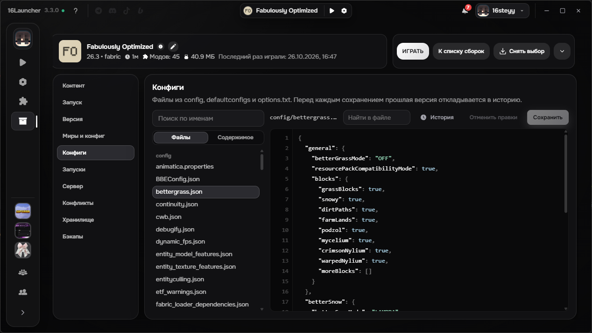

- Поиск по всем конфигам сборки, подсветка синтаксиса и проверка TOML.
- История версий файла с просмотром изменений.

## - Миры и хранилище

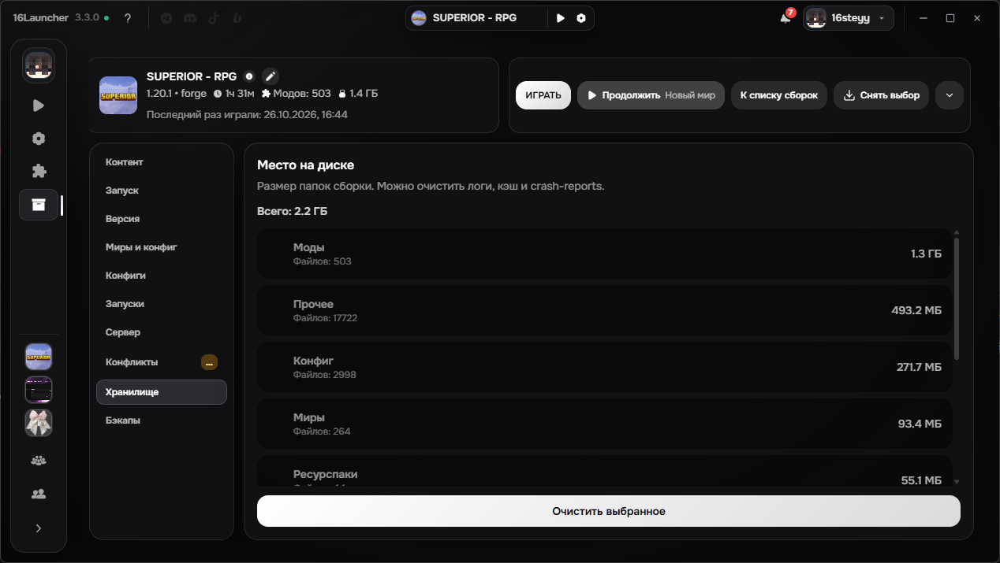

- Список миров с возможностью удалить мир или открыть его папку.
- Карта чанков: обзор измерений, отрисовка регионов и удаление выбранных чанков.
- Размер папок сборки и очистка логов, краш-репортов и кэша одним действием.

## - Наборы модов

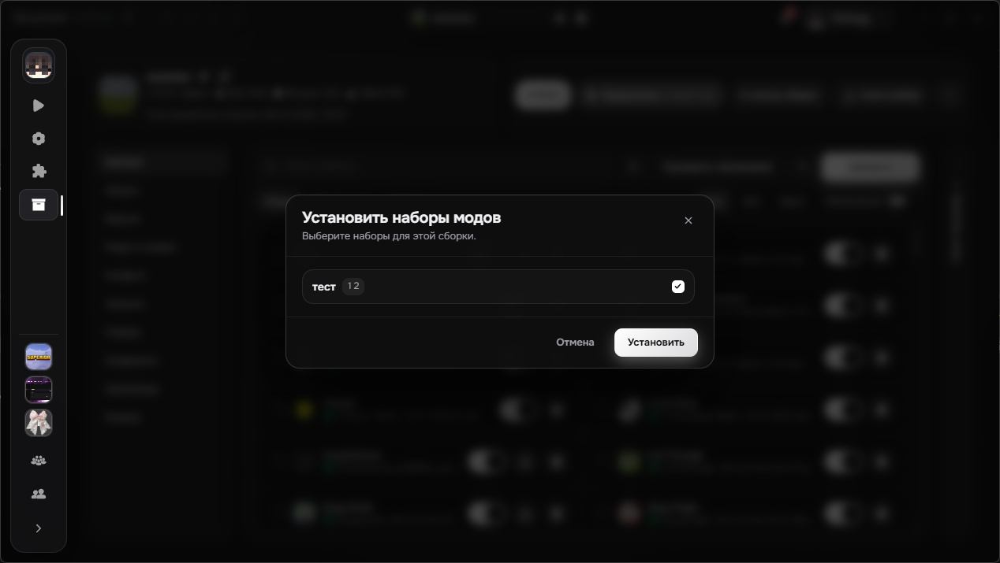

- Сохраняйте список модов из Modrinth или CurseForge и ставьте его в любую сборку одним действием.

## - Сборщик серверного пакета

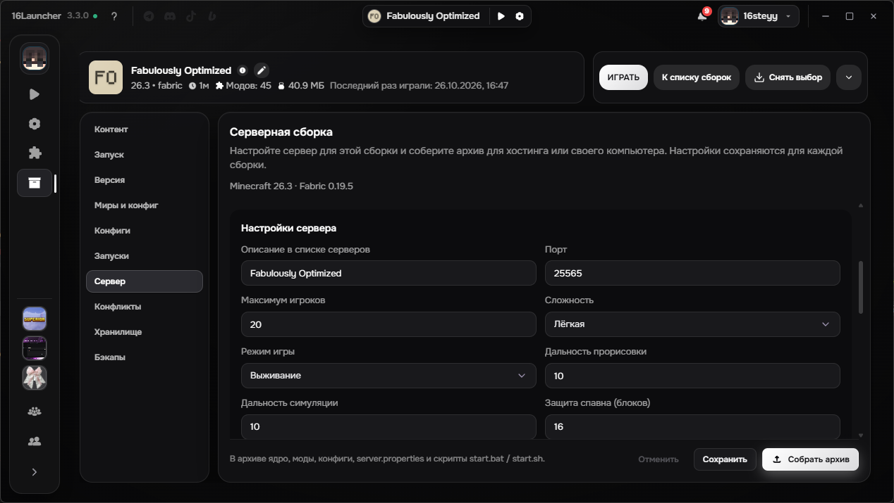

- Соберите сервер для своей сборки: ядра Vanilla, Paper, Purpur, Fabric, Forge и NeoForge.
- Клиентские моды отфильтруются автоматически, а в пакет добавятся `server.properties` и скрипты запуска.

## - Новый интерфейс

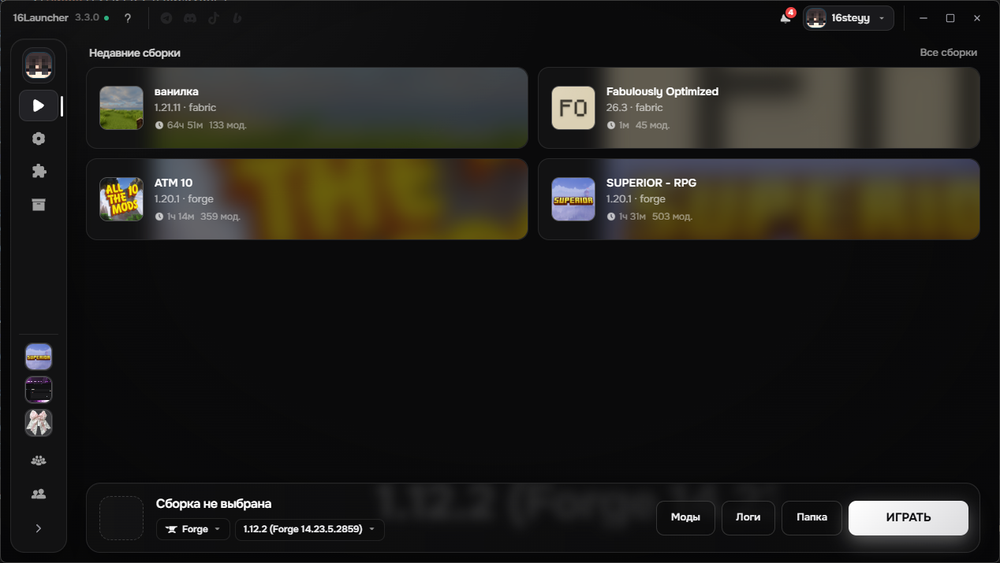
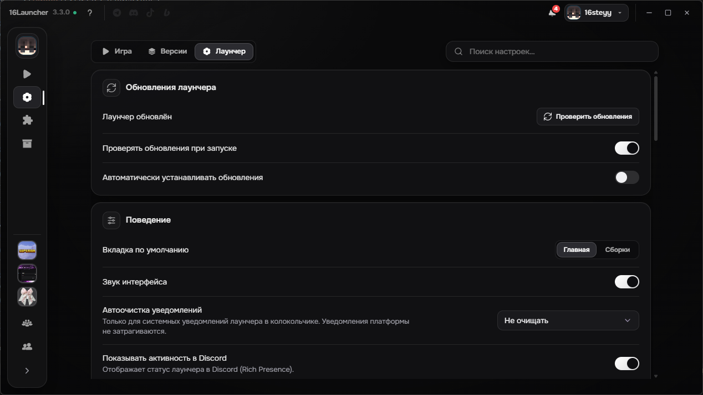
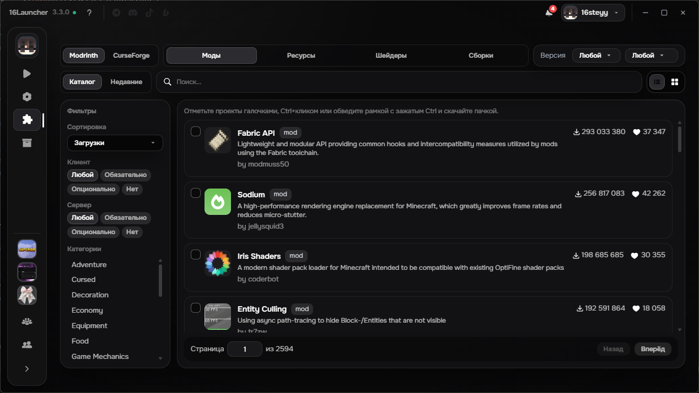

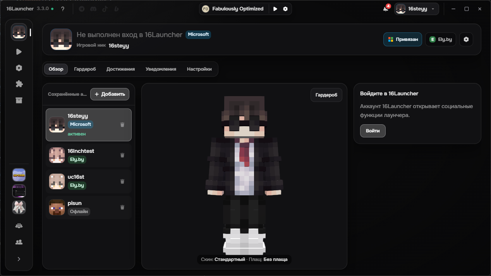
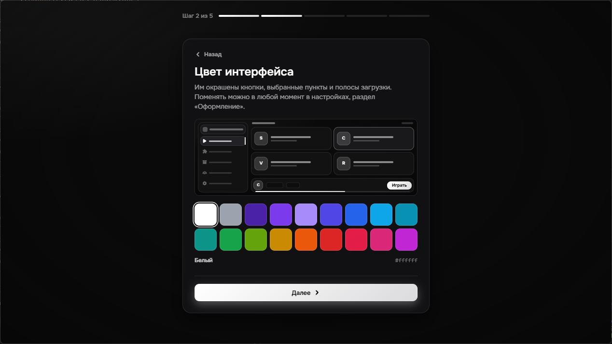

- Новый интерфейс и новая тема. Цвета подстраиваются под фоновое изображение.
- Командная палитра (`Ctrl+K`) и горячие клавиши для большинства действий. Справка по ним открывается клавишей `F1`.
- Переработан онбординг для новых пользователей.
- В консоли игры появились фильтры по уровням сообщений.

## - Гардероб

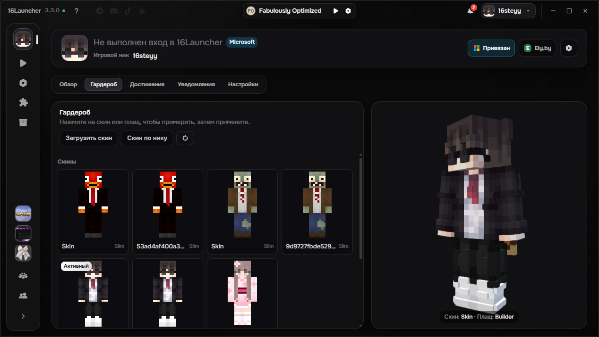

- Удобный выбор скинов и плащей с предпросмотром до применения.
- Скин можно загрузить файлом или по нику.

## - Восстановление пароля

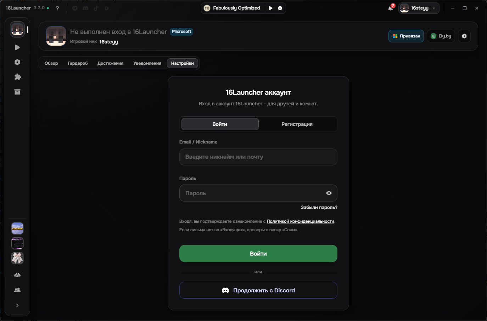

- Добавлена функция «Забыли пароль».

## Улучшено

- Лаунчер больше не блокирует запуск, если игра уже запущена: он найдёт процесс и подхватит сессию.
- Ядро запуска стало стабильнее.
- Зеркала загрузки с автоматическим переключением при сбоях. Режимы: «авто», «официальные» и «зеркало».
- Выбор видеокарты для игры (Windows).
- Системные уведомления, когда лаунчер свёрнут или находится в трее.
- Настройки и профили записываются с резервной копией, поэтому не портятся при сбое во время записи.
- Ник автоматически приводится к допустимому виду.
- Улучшена стабильность комнат.

# Исправлено

### - Исправлены падения профилей и загрузки с Modrinth
### - Исправлены ошибки в Linux

Нашли баг? Сообщите об этом в нашем [Discord](https://discord.gg/55Y95EfsHM) или откройте issue на [GitHub](https://github.com/launcherdev11)!

Хотим выразить благодарность за поддержку проекта нашим бустерам: Forgetich, karatelka220, AsukaPrime, Aegis_patris, D1kson16. Благодаря вашей финансовой поддержке проект развивается значительно быстрее и получает больше возможностей становиться лучше. 

Если вы хотите поддержать проект и помочь его дальнейшему развитию, вы можете стать [нашим бустером на Boosty](https://boosty.to/16steyy)! Для бустеров предусмотрена награда в виде эксклюзивного бейджа **«Спонсор»** в лаунчере и благодарность в списках обновлений!
