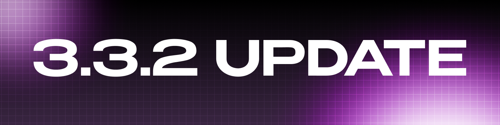
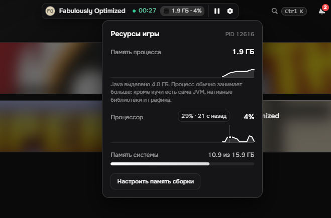
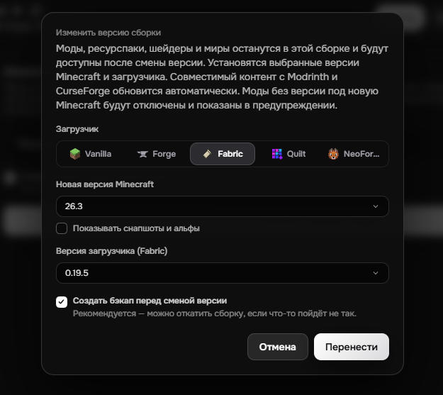
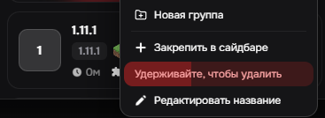
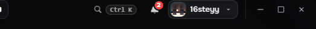

# Обновление 3.3.2

  

  

  

  

## Что нового

Добавлен мониторинг ресурсов, смена загрузчика сборки, UI изменения, а также исправление багов. 

## Добавлено

## - Мониторинг ресурсов

- При запуске игры в шапке лаунчера появляется мини-бейдж с краткой информацией о потреблении ресурсов игрой. При нажатии открывается окошко с более подробной информацией.

## - Смена загрузчика сборки

- Теперь можно поменять не только версию игры сборки, но и его загрузчик.

## - Удаление сборки

- Теперь, чтобы удалить сборку, нужно зажать кнопку удаления на 1 секунду, вместо обычной кнопки

## - Палитра команд

- Раньше палитра открывалась комбинацией `ctrl + k` и нигде не упоминалась в UI. В этом патче палитра была выведена в шапку лаунчера.

## Улучшено

- Лаунчер стал озывчевее.
- Добавлено больше маленьких анимаций.

# Исправлено

### - Исправлены ошибки с запуском.
### - Исправлены ошибки с авторизацией.

Нашли баг? Сообщите об этом в нашем [Discord](https://discord.gg/55Y95EfsHM) или откройте issue на [GitHub](https://github.com/launcherdev11)!

Хотим выразить благодарность за поддержку проекта нашим бустерам: Forgetich, karatelka220, AsukaPrime, Aegis_patris, D1kson16. Благодаря вашей финансовой поддержке проект развивается значительно быстрее и получает больше возможностей становиться лучше. 

Если вы хотите поддержать проект и помочь его дальнейшему развитию, вы можете стать [нашим бустером на Boosty](https://boosty.to/16steyy)! Для бустеров предусмотрена награда в виде эксклюзивного бейджа **«Спонсор»** в лаунчере и благодарность в списках обновлений!
