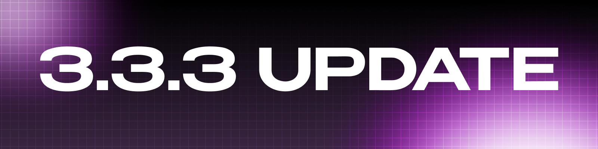
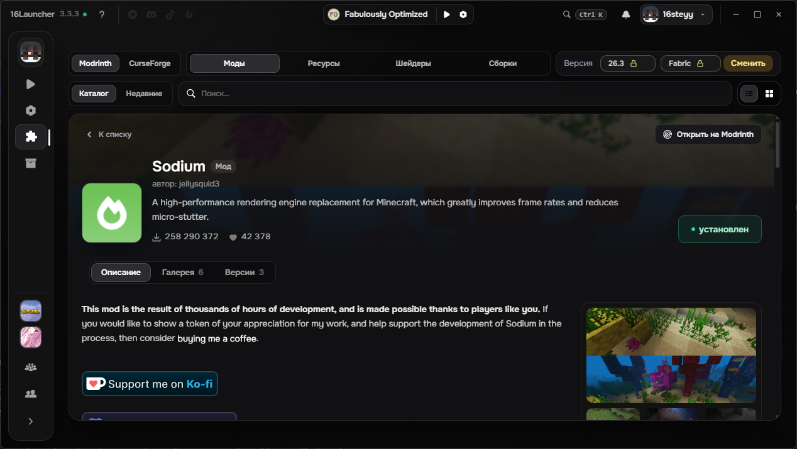
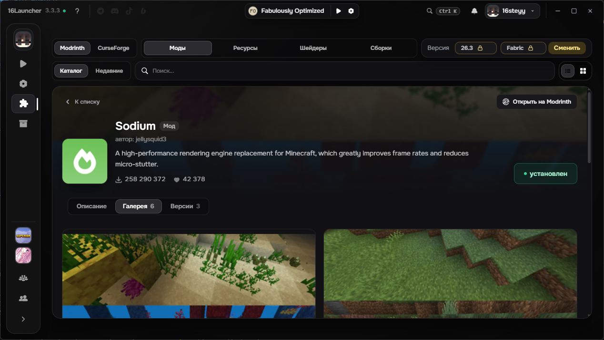
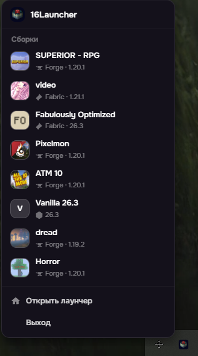
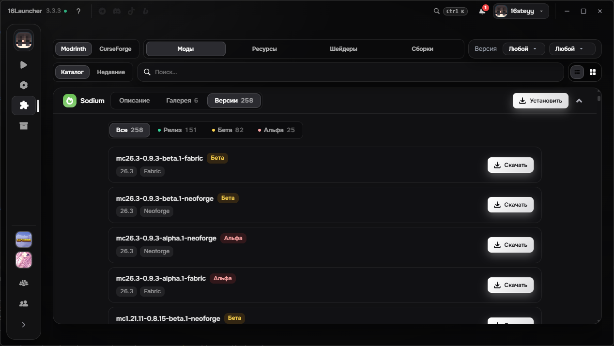
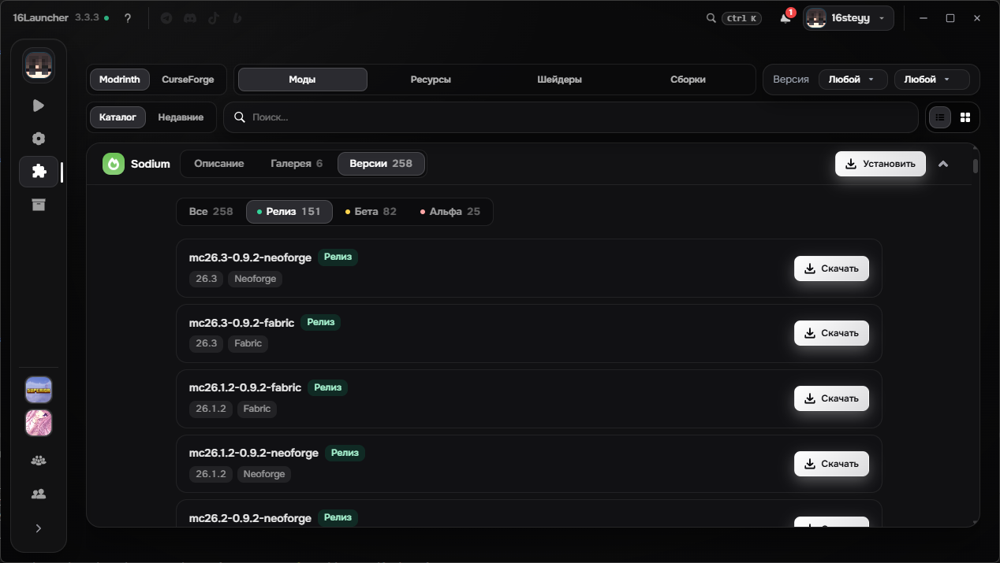
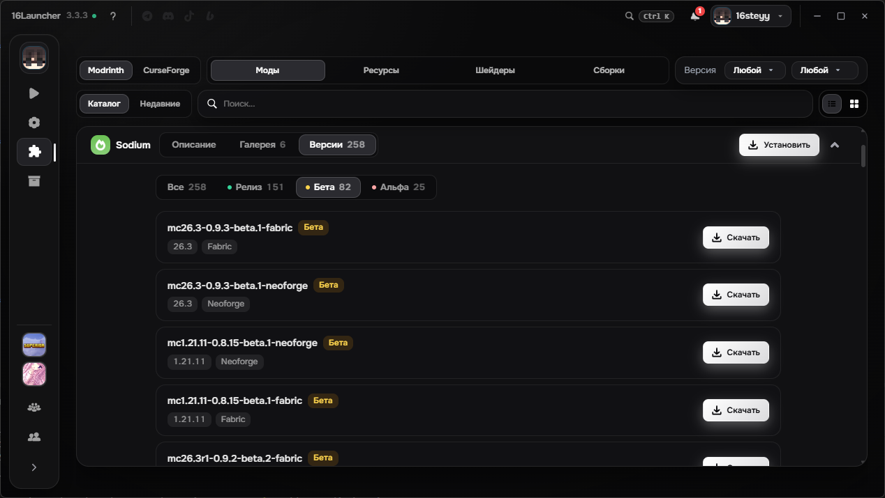
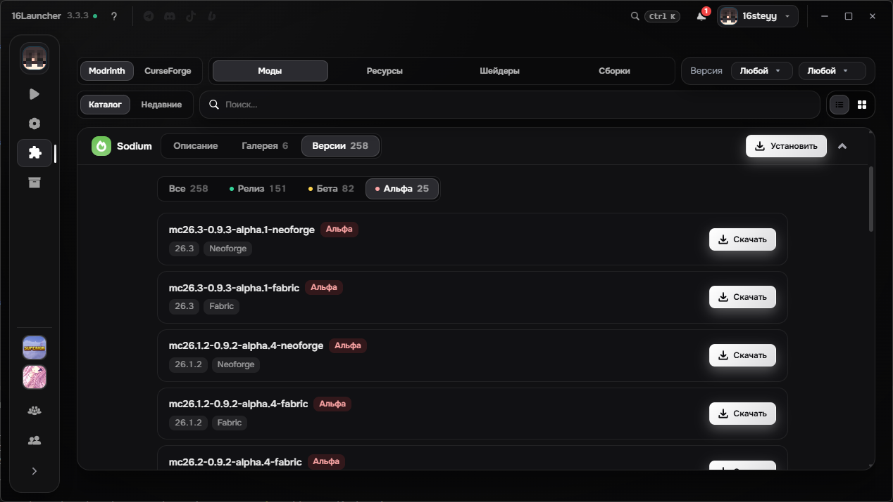

# Обновление 3.3.3

  

  

  

  

## Что нового

Изменение страницы контента из каталога, улучшенный вид трея, выбор каналов версий у контента, исправление багов с запуском и загрузкой Forge.

## Добавлено

## - Страница контента

- Улучшена страница просмотра мода\ресурспака\шейдера\сборки. 

## - Новый вид лаунчера в трее

- Стандартный системный вид меню заменён на кастомный интерфейс в стиле лаунчера.

## - Выбор каналов версий

- Добавлена возможность выбора канала контента с разделением на три стандартные категории: Бета, Релиз и Альфа.

# Исправлено

### - Исправлена установка и запуск старых Forge-версий.
### - Исправлена ошибка, из-за которой при переходе на другую страницу каталога сбрасывался выбранный контент.

Нашли баг? Сообщите об этом в нашем [Discord](https://discord.gg/55Y95EfsHM) или откройте issue на [GitHub](https://github.com/launcherdev11)!

Хотим выразить благодарность за поддержку проекта нашим бустерам: Forgetich, karatelka220, AsukaPrime, Aegis_patris, D1kson16. Благодаря вашей финансовой поддержке проект развивается значительно быстрее и получает больше возможностей становиться лучше. 

Если вы хотите поддержать проект и помочь его дальнейшему развитию, вы можете стать [нашим бустером на Boosty](https://boosty.to/16steyy)! Для бустеров предусмотрена награда в виде эксклюзивного бейджа **«Спонсор»** в лаунчере и благодарность в списках обновлений!
